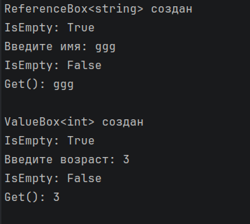

# КТ №26 — Ограничения ссылочного типа и типа значения

**Вариант 1 — Обёртки**

- `ReferenceBox<T> where T : class` с методами `Set(T item)`, `bool IsEmpty`, `T? Get()`, использующий `null` как «пустое» состояние.
- `ValueBox<T> where T : struct` с тем же набором методов, использующий `Nullable<T>` (`T?`) как «пустое» состояние.
- Продемонстрирован `ReferenceBox<string>`: пустое и заполненное состояние.
- Продемонстрирован `ValueBox<int>`: пустое и заполненное состояние.
- Закомментированным кодом с пояснением показано, что `ReferenceBox<int>` и `ValueBox<string>` не компилируются (ошибки CS0452 и CS0453).

Все данные вводит пользователь; неверный ввод (пустая строка, не целое число) запрашивается повторно.

## Проверочные ключи

| Действие | Ожидаемый результат |
|---|---|
| новый ReferenceBox<string> | IsEmpty == true |
| после Set("Алина") | IsEmpty == false, Get() == "Алина" |
| новый ValueBox<int> | IsEmpty == true |
| после Set(25) | IsEmpty == false, Get() == 25 |

## Запуск

```
dotnet run
```

## Результат выполнения


